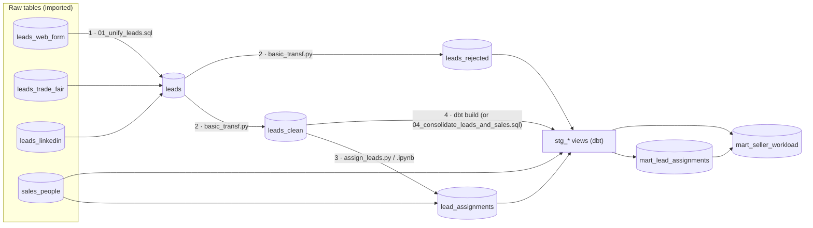

# Compute quickstart: lead assignment

A small end-to-end pipeline on ClickHouse that shows the same business problem solved with each tool:
leads arrive from 3 sources in different formats, get unified, cleaned, assigned to the
sales person who speaks their language and knows their topic, and finally reported on.

The raw data comes from two origins, and importing it into ClickHouse is part of the exercise
(it is not done by this code):

| Origin | Tables | Created with |
|--------|--------|--------------|
| Postgres database | `leads_web_form`, `leads_linkedin`, `sales_people` | [../reference_data/create_reference_data.sql](../reference_data/create_reference_data.sql) (run it once in Postgres, e.g. Neon) |
| Excel files | `leads_trade_fair` | [leads_trade_fair.xlsx](../reference_data/leads_trade_fair.xlsx) and, optionally, [leads_trade_fair_2.xlsx](../reference_data/leads_trade_fair_2.xlsx) (a second fair, same format) |



## Where the tables go

ClickHouse has no schemas, so every table and view lives in one **existing** database, `DB_NAME`
(for example `pre_bizdoc`). Nothing is created at the database level.

| Layer | Tables | Built by |
|-------|--------|----------|
| Raw | `leads_web_form`, `leads_linkedin`, `sales_people` | You: import from the Postgres origin |
| Raw | `leads_trade_fair` | You: import from the trade-fair Excels |
| Staging | `leads`, `leads_clean`, `leads_rejected`, `lead_assignments`, views `stg_*` | SQL, Python and dbt |
| Marts | `mart_lead_assignments`, `mart_seller_workload` | dbt |

The pipeline starts from the 4 raw tables, so import them into `DB_NAME` first, with the column names they have at
the origin (see [Raw tables](#1-raw-tables)). Each step after that drops and recreates its tables, so
make sure `DB_NAME` has no other tables with these names.
Your user needs to create, drop, insert into and select from tables and views in `DB_NAME`; it does not need
`CREATE DATABASE`.

`DB_PORT` is the HTTP port: `8123`, or `8443` for HTTPS (e.g. ClickHouse Cloud), which Python and dbt detect
automatically. dbt uses `DB_NAME` as its schema, which in ClickHouse is the database.

## How to run

Prerequisites: a ClickHouse database, `clickhouse client` for the SQL step, and the packages in `requirements.txt`
(dbt needs the **dbt-clickhouse** adapter). Commands run from this folder unless they say otherwise.

```bash
cd compute
pip install -r requirements.txt
cp .env.example .env              # then fill it in (see Credentials)
set -a; source .env; set +a       # only needed for clickhouse client and dbt

# 1. Import the raw tables into DB_NAME (your ingestion step, not part of this folder):
#    leads_web_form, leads_linkedin, sales_people from Postgres; leads_trade_fair from the Excels

# 2. Unify the leads into the leads table
#    clickhouse client uses the native port (9000, or 9440 with --secure), not DB_PORT
clickhouse client --host $DB_HOST --user $DB_USER --password "$DB_PASSWORD" --database $DB_NAME \
    --multiquery < sql/01_unify_leads.sql

# 3. Clean the leads into leads_clean + leads_rejected
python python_ipynb/basic_transf.py               # --dry-run: compute only; --checks: read-only report

# 4. Assign leads to sellers into lead_assignments
python -m python_ipynb.assign_leads                  # incremental
python -m python_ipynb.assign_leads --full-refresh   # rebuild everything
python -m python_ipynb.assign_leads --dry-run        # compute only
#    ...or run python_ipynb/assign_leads.ipynb top to bottom instead
#    (or python_ipynb/assign_leads_standalone.ipynb, which needs no utils/ and runs from any folder)

# 5. dbt: stg_* views, mart_* tables, plus tests
cd dbt && dbt build
#    (from another folder: python -m dbt.cli.main build --project-dir compute/dbt --profiles-dir compute/dbt)

# 5'. ...or the same without dbt, in plain SQL (last query = the dbt tests, all should be 0)
clickhouse client --host $DB_HOST --user $DB_USER --password "$DB_PASSWORD" --database $DB_NAME \
    --multiquery < sql/04_consolidate_leads_and_sales.sql
```

## Contents

Paths are relative to this folder.

| # | Demo | Files |
|---|------|-------|
| 1 | Raw tables | Imported by you from Postgres and Excel (see below) |
| 2 | SQL | `sql/01_unify_leads.sql` |
| 3 | Python basic (single file) | `python_ipynb/basic_transf.py` → `run_cleaning(...)` (and `run_checks(...)` for a read-only report). Self-contained: it imports nothing from `utils/` |
| 4 | Python complex (package) | `python_ipynb/assign_leads.py` → `run_assignment(...)`, helpers in `python_ipynb/utils/` |
| 5 | Jupyter | `python_ipynb/assign_leads.ipynb` (imports `utils/`), or `python_ipynb/assign_leads_standalone.ipynb` (same flow and result, with the `utils/` code inside the notebook) |
| 6 | dbt | `dbt/`, or its plain-SQL alternative `sql/04_consolidate_leads_and_sales.sql` |

### 1. Raw tables

Import them into `DB_NAME` with the column names they have at the origin; the pipeline reads those names.

| Table | Origin | Rows | Format quirks |
|-------|--------|-----:|---------------|
| `leads_web_form` | Postgres | 40 | Full name in one field, language as English name (`Spanish`), interest as label (`BI & Analytics`) |
| `leads_trade_fair` | Excel | 25 (+20) | Spanish headers (`idioma`, `tema_interes`), ISO codes with messy casing (`CA`, `en `), Spanish labels. `leads_trade_fair_2.xlsx` adds 20 leads from another fair (`FAIR-026`…`FAIR-045`), loaded into the same table |
| `leads_linkedin` | Postgres | 35 | Numeric ids, locale codes (`es_ES`), campaign codes (`GENAI`) |
| `sales_people` | Postgres | 9 | `languages` / `specialties` as `;`-separated lists, capacity (`max_open_leads`), `active` flag (`Yes`/`No`) |

Timestamp columns (`submitted_at`, `fecha_contacto`, `created_ts`) can arrive as `DateTime`, `DateTime64` or text.

Canonical values: languages `es, ca, en, fr, de, pt`; contents `data_engineering, bi_analytics,
machine_learning, genai, data_governance, cloud_platforms`.

Some data-quality issues are injected on purpose, so the cleaning and the assignment have something to show:

| Record | Issue | What the cleaning does |
|--------|-------|------------------------|
| `WEB-0007` | missing e-mail | kept in `leads_clean`, flagged `missing_email` |
| `WEB-0012` | malformed e-mail (no `.com`) | e-mail set to NULL, flagged `invalid_email` |
| `FAIR-005` | language `it`: no seller speaks Italian | moved to `leads_rejected` (`unsupported_language`) |
| `FAIR-011` | interest `Blockchain`: not a content we offer, so it maps to NULL | kept, flagged `unknown_content` (gets a language-only match) |
| `LI-90003` | same person as `WEB-0003` (cross-source duplicate) | merged into the oldest lead, `WEB-0003` (`merged_lead_ids`) |
| `S08` | inactive seller, who must never get leads | nothing: the assignment skips inactive sellers |

To change the data: the Postgres tables are defined in `reference_data/create_reference_data.sql` (edit it directly);
the trade-fair Excels are written by `reference_data/generate_reference_data.py` (seeded, so the output is deterministic).

### 3. Cleaning rules

`run_cleaning` reads `leads` and replaces two tables: `leads_clean` (input of the assignment) and `leads_rejected`.
It fixes what can be fixed, flags in `dq_issues` what cannot be fixed but does not block the assignment, and rejects
what cannot be assigned. It returns (and prints) one row per action taken.

| Problem | Action |
|---------|--------|
| `lead_id` missing | rejected (`missing_lead_id`) |
| `lead_id` repeated | first row kept, the rest dropped |
| Language not supported | rejected (`unsupported_language`) |
| E-mail with an invalid format | set to NULL, flagged `invalid_email` |
| E-mail missing | kept, flagged `missing_email` |
| Same e-mail in several leads | oldest lead kept; the others are merged into it and listed in `merged_lead_ids` |
| Content not supported or missing | set to NULL, flagged `unknown_content` |
| `created_at` in the future | kept, flagged `future_created_at` |

`run_checks` (or `python python_ipynb/basic_transf.py --checks`) still gives the read-only diagnosis of `leads` and
`sales_people`, without writing anything.

### 4. Assignment rules

Leads are processed in order of arrival. For each lead:
1. **full_match**: an active seller who speaks the lead's language *and* is specialized in its content.
2. **language_only**: if no specialist is available, any active seller who speaks the language.
3. **unassigned**: nobody speaks the language, or every candidate is at capacity.

Within a tier, the seller with the lowest *assigned / capacity* ratio wins (ties go to the lower `seller_id`).
Each row stores the `match_type` and a human-readable `reason`.
The process is incremental: only leads of `leads_clean` not yet in `lead_assignments` are assigned, unless
you use `--full-refresh`.

```
python_ipynb/
├── assign_leads.py          # main: run_assignment() + CLI, uses relative imports (from .utils...)
├── assign_leads.ipynb       # same flow as a notebook (imports utils/)
├── assign_leads_standalone.ipynb  # same notebook with the utils/ code inlined: no local imports
└── utils/
    ├── db.py                # connection + read/write tables (the only ClickHouse-specific module)
    └── matching/
        ├── sellers.py       # normalize the raw sellers table
        ├── candidates.py    # candidate tiers + least-loaded pick
        └── assignment.py    # assign_leads() algorithm (pure pandas, no DB)
```

**About relative imports.** `assign_leads.py` uses `from .utils...`, so it has to run as a module
(`python -m python_ipynb.assign_leads`) from `compute/`. A notebook is not part of a package, so
`from .utils` fails there. Instead the notebook imports `utils` relative to its own folder, which is the
Jupyter working directory. Inside `utils/`, the modules still import each other relatively.

### 6. dbt (or plain SQL)

`dbt build`, or `sql/04_consolidate_leads_and_sales.sql` if you prefer not to use dbt, creates in `DB_NAME`
(same names, same logic and same result with either; run one of them):

- **`stg_*` views** (staging): one per input table (`stg_leads`, `stg_leads_rejected`, `stg_sales_people`,
  `stg_lead_assignments`). A view is a saved query, so it stores no data and always shows the current input.
  They select and type the columns the marts need (e.g. seller languages as arrays).
- **`mart_lead_assignments`** (table): the final table, one row per lead with its data, its data-quality flags
  (`dq_issues`, `merged_lead_ids`), its seller and how it was assigned. `match_type` is `full_match`,
  `language_only`, `unassigned`, `rejected` (set aside by the cleaning, reason in `match_reason`) or `pending`
  (clean, but not processed by the assignment yet). Leads merged as duplicates appear only in `merged_lead_ids`.
- **`mart_seller_workload`** (table): one row per seller with assigned leads, match quality and free capacity.
- **Tests**, e.g. `lead_id` unique and not null, one lead per e-mail, and no seller over capacity
  (`tests/assert_sellers_within_capacity.sql`). dbt fails the build if one fails; the SQL script instead ends
  with a query that returns one row per test with its failing rows (all should be 0).

ClickHouse does not enforce primary keys: `lead_id` / `seller_id` are the sorting keys of the marts, and the dbt
tests are what guarantee they are unique.

The marts are rebuilt on every run, so they show the current state, not its history.

## Credentials

Every Python entry point takes a single `creds` argument:

| Value | When |
|-------|------|
| `dict` with keys `DB_HOST, DB_PORT, DB_USER, DB_PASSWORD, DB_NAME` | **In Intelek.** The secret object is injected into the function as a dictionary |
| `None` (default) | **On your laptop.** Reads the same variables from `compute/.env` |

```python
creds = {
    "DB_HOST": "xxxx.eu-central-1.aws.clickhouse.cloud",
    "DB_PORT": 8443,          # HTTP(S) port: 8443 = HTTPS (e.g. ClickHouse Cloud), 8123 = HTTP
    "DB_USER": "default",
    "DB_PASSWORD": "...",
    "DB_NAME": "pre_bizdoc",  # existing database where every table lives
}
```

**On your laptop:** copy `.env.example` to `.env` (git-ignored) and fill it in. Python loads it
automatically, and its values take precedence over variables with the same name already set in your shell.
dbt and the SQL client read the same variables from the shell, so load the file first:
`set -a; source .env; set +a`.

**In Intelek:**

1. Create a secret object with the keys `DB_HOST`, `DB_PORT`, `DB_USER`, `DB_PASSWORD` and `DB_NAME`.
2. Create a Python task that points to the function, and inject the secret as `creds`:

| Task | Function (in `compute/`) | Secret injected as |
|------|--------------------------|--------------------|
| Data cleaning | `python_ipynb/basic_transf.py` → `run_cleaning` | `creds` |
| Lead assignment | `python_ipynb/assign_leads.py` → `run_assignment` | `creds` |

**Notebook.** Intelek runs notebooks with papermill and injects `creds` in the first cell. The cell tagged
`parameters` in `assign_leads.ipynb` sets `creds = None` only if it is not defined yet, so it works both with
that injection and with plain papermill (which injects right after the `parameters` cell); locally it falls back
to `.env`. The notebook also finds `utils/` whether it runs from its own folder (Jupyter) or from the repo root.

**dbt** has no Python function, so `dbt/profiles.yml` reads the same `DB_*` environment variables.
The file holds no secrets and is committed. dbt picks it up from the project folder.

## Expected result with the bundled data

- **Cleaning:** 100 leads → 98 in `leads_clean` (3 flagged), 1 in `leads_rejected` (`FAIR-005`), 1 merged (`LI-90003` into `WEB-0003`).
- **Assignment:** 98 leads, 8 unassigned (candidates at capacity), and S08 gets 0 leads.
- **dbt:** 4 views + 2 tables + 22 tests, all passing. `mart_lead_assignments` has the 99 leads: 69 `full_match`, 21 `language_only`, 8 `unassigned`, 1 `rejected`.

With `leads_trade_fair_2.xlsx` also loaded into `leads_trade_fair`: 120 leads → 118 clean, 1 rejected, 1 merged;
22 unassigned.
